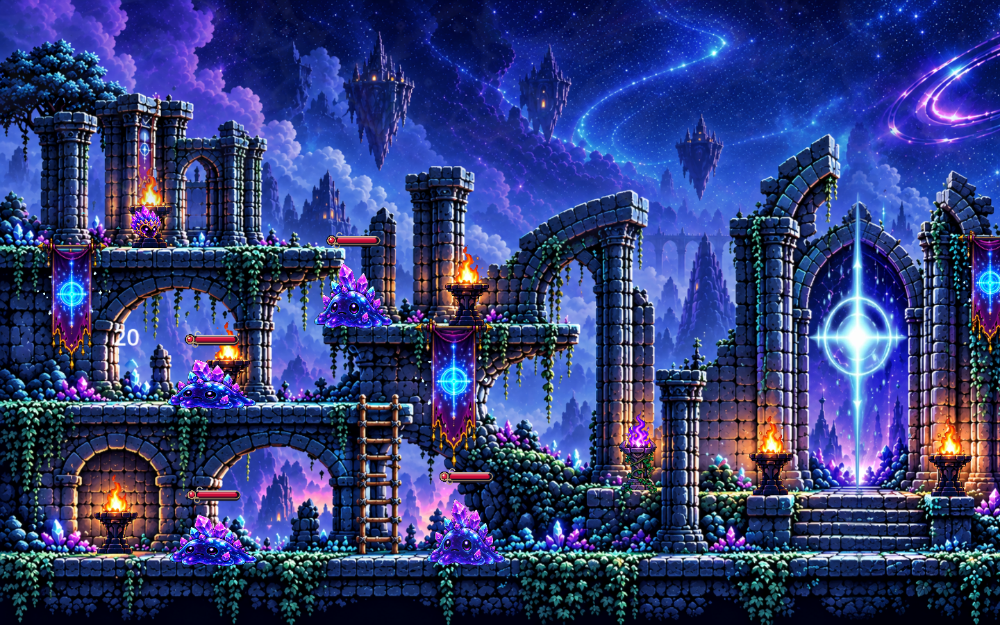
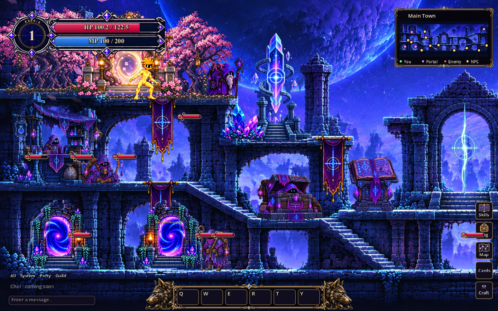
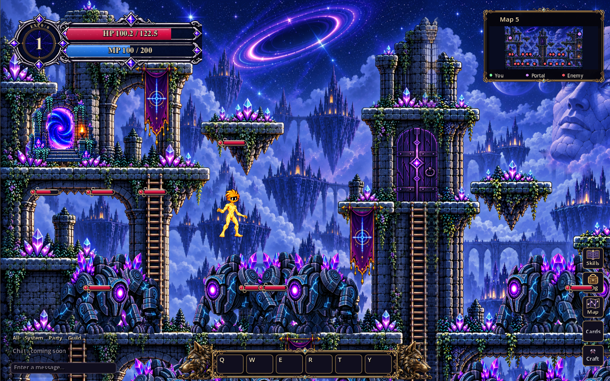
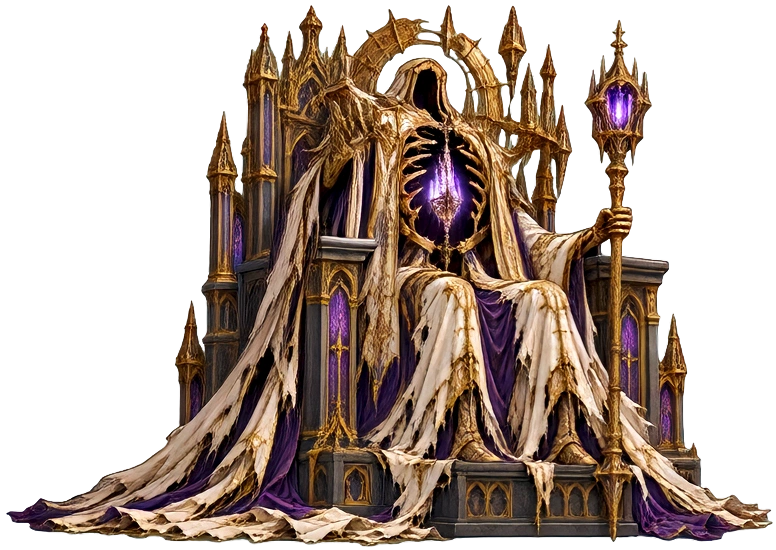
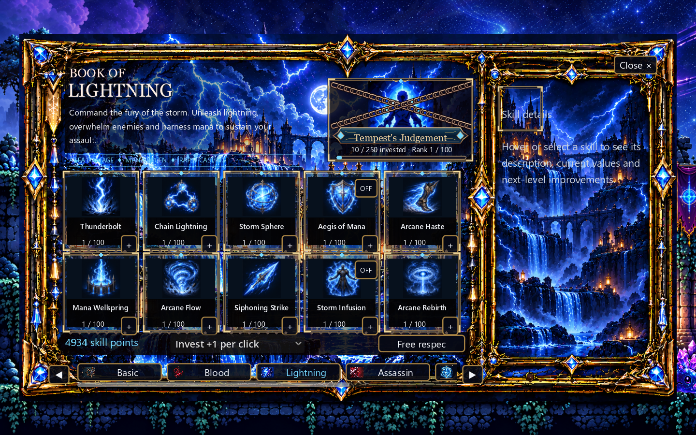
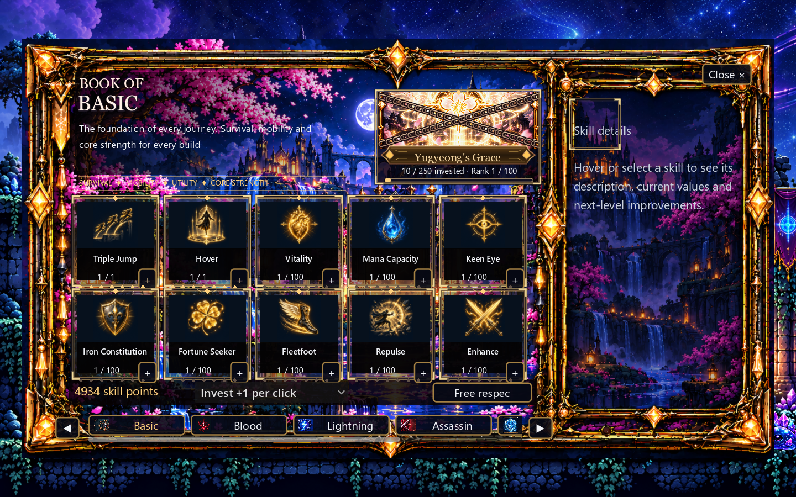
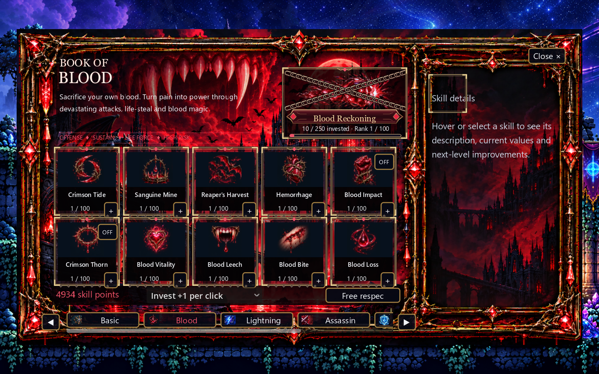
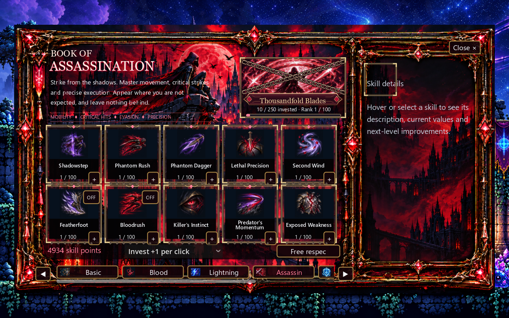
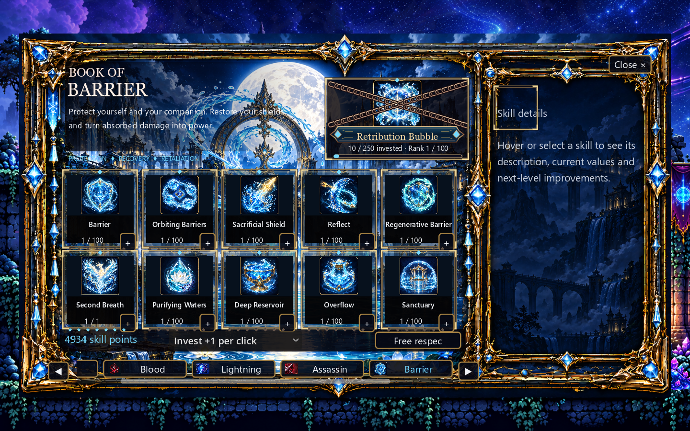
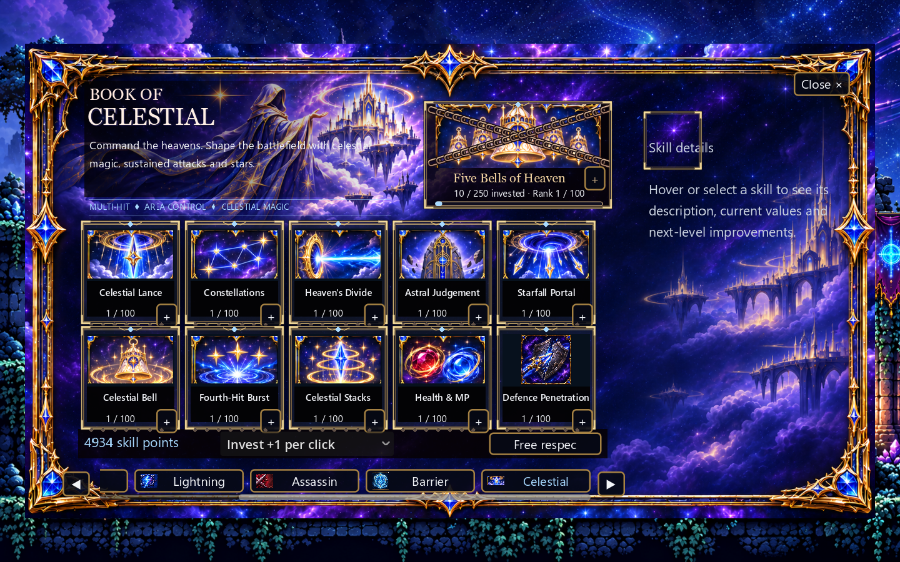

# Godot 2D RPG — Technical Showcase

**Godot 4.7 · GDScript · Gameplay systems · Interface design**

Selected code and screenshots from Dean Jefferies' ongoing 2D action RPG. The project combines connected platforming environments, enemy encounters, persistent equipment and six skillbooks. This repository is a curated technical showcase, not a complete game distribution.

## Explore the project

| Area | What to inspect |
|---|---|
| [Maps and monsters](#maps-and-monsters) | World presentation, encounters and minimap |
| [Skillbook interface](#skillbook-interface) | Six skill categories, ranks and point investment |
| [Selected code](#selected-code) | Item data, targeting and a timed enemy attack |
| [How to use this repository](#how-to-use-this-repository) | Navigate the gallery and source extracts |

## Maps and monsters

### Main town

The town brings together NPCs, storage, portals and the skillbook interaction within a connected platform layout.

### Map five

### Boss visual preview

An isolated preview of a boss used in the project. This image shows the visual asset rather than a combat recording; it is included as project context, not a claim of original illustration work.

## Skillbook interface

The current catalog contains **Basic, Blood, Lightning, Assassin, Barrier and Celestial**. Screenshots were captured from the current source on 5 November 2026 using an isolated demonstration profile with all books unlocked. Normal progression controls which books appear. The tab strip scrolls, so not all six labels fit at once.

### Lightning — skill cards and investment controls

### Basic and Blood

### Assassin and Barrier

### Celestial

## Selected code

| File | Responsibility | Concepts |
|---|---|---|
| [ItemInstance.gd](code/ItemInstance.gd) | Preserve item identity and convert state to/from dictionaries | Serialization, defaults, deep copying |
| [combat-EnemyRegistry.gd](code/combat-EnemyRegistry.gd) | Register enemies, remove invalid references and select targets | Object lifecycle, collections, spatial queries |
| [FoxDash.gd](code/FoxDash.gd) | Manage attack windup, movement, recovery and cooldown | Timing, collision checks, state transitions |

These extracts retain their original game dependencies. `FoxDash` depends on its parent character and sprite assets; the registry integrates with world events; item instances are consumed by the wider inventory system. They cannot be run independently from this repository.

## How to use this repository

1. Read the gallery above, or open `screenshots/` to inspect individual captures.
2. Open `code/` and choose a system from the table.
3. Read the system overview below for context before inspecting its methods.

### Item persistence

An item has a unique identifier separate from its definition. Its upgrade level, appearance and attributes can be serialized without creating a new identity during transfers. `from_dict` supplies defaults for missing values.

### Enemy targeting

Enemies register with a shared registry. Invalid references are cleaned up before queries. Target selection filters unsuitable nodes and searches within a range, keeping targeting concerns in one place.

### Attack timing

The dash separates windup, travel and recovery. It checks available floor and walls, applies movement through the existing character collider and tracks already-hit targets. Cooldown prevents immediate repeats.

## Status and development

**Work in progress.** Movement, character presentation and balance are still under development; no video or finished-release claim is included. The broader project is developed with AI assistance. This gallery documents project systems and integration, not sole authorship of every code line or visual asset.

The complete local project uses Godot 4.7.1. This showcase intentionally excludes the full asset library, save data, backups and editor caches. Its selected source extracts have not been tested as standalone applications.
